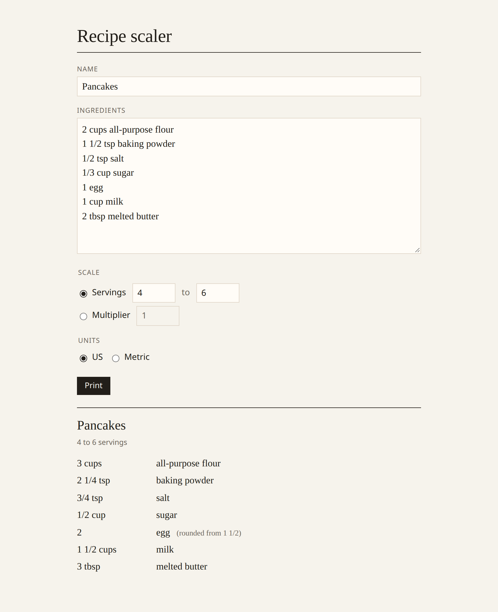

# recipe-scaler

Scale a pasted ingredient list by servings or a multiplier, and switch between US and metric.

https://frozenmango8.github.io/recipe-scaler/



## Run locally

```sh
npm install
npm test
npm run dev
```

The dev server is at http://localhost:5173/recipe-scaler/.

## Limitations

- Volume converts to volume and weight to weight. A cup of flour is not turned into grams.
- Measures are kitchen ones: 1 cup = 240 ml, 1 tbsp = 15 ml, 1 tsp = 5 ml. Bare `oz` is weight; write `fl oz` for volume.
- Quantities the parser doesn't recognize (`one cup`, `a handful`) are left as written.
- Eggs round to a whole number, with the unrounded amount in a note. Under 1/8 tsp becomes "a pinch".
